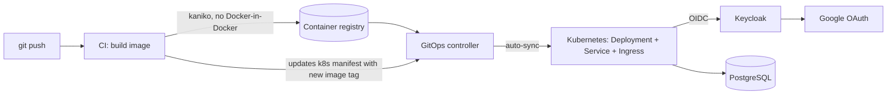

# Hitman IT

Portfolio and services site for an IT infrastructure / live-streaming / training
business — built with Django, deployed to Kubernetes through a GitOps pipeline.

**Live:** [hitman.barysgame.kz](https://hitman.barysgame.kz)

## Stack

- **Django 4.2**, PostgreSQL
- Templates + vanilla JS — no frontend build step, no Node in the loop
- **WhiteNoise** serves static files straight from the app process (no separate nginx/CDN)
- **Keycloak** SSO federated to Google OAuth (`mozilla-django-oidc`)

## Features

- **Services showcase** — one page per pricing/services area, cut down from three
  overlapping pages that used to describe the same six services differently.
- **Quote constructor** (`/smeta/`) — client-side price calculator that also saves
  a lead server-side. Open to anonymous visitors (a login wall before pricing was
  killing B2B conversions), guarded against abuse with a honeypot field, a
  required-contact check, and a per-IP rate limit. Telegram/email notifications on
  new leads are best-effort — a failed notification never blocks or loses the lead.
- **Training course** — 31 bilingual (RU/KZ) modules with interactive quizzes and an
  SVG progress ring, gated behind login.
- **Photo/video gallery** — drop an image into `static/img/gallery/<category>/` and
  it shows up on the site automatically, no code change or extra deploy; admin-
  uploaded photos through Django admin are merged in from the same view.
- **Blog + SEO** — `sitemap.xml`/`robots.txt`, with login-gated routes correctly
  excluded from both.

## Architecture



- `Dockerfile` builds via **Kaniko** (no privileged runner needed), then
  `docker-entrypoint.sh` runs `migrate` before starting `gunicorn`.
- The CI deploy stage pins the manifest's image tag to the exact commit SHA and
  pushes that change back to `main` — so the GitOps controller sees a real diff on
  every build and syncs automatically, no manual rollout restarts.
- `k8s/` holds plain manifests (no Helm/Kustomize): `Deployment`, `Service`,
  `Ingress` with TLS via cert-manager.

## Local development

```bash
cd django_site
pip install -r requirements.txt
python manage.py migrate
python manage.py createsuperuser   # to log into /admin/
python manage.py runserver
```

Open `http://127.0.0.1:8000/`. See [`django_site/README.md`](django_site/README.md)
for the full model/admin reference. Copy `django_site/.env.example` to `.env` to
configure OIDC, lead notifications, and analytics locally.

## Author

Aidyn Kakanov — [barysgame.kz](https://barysgame.kz)
